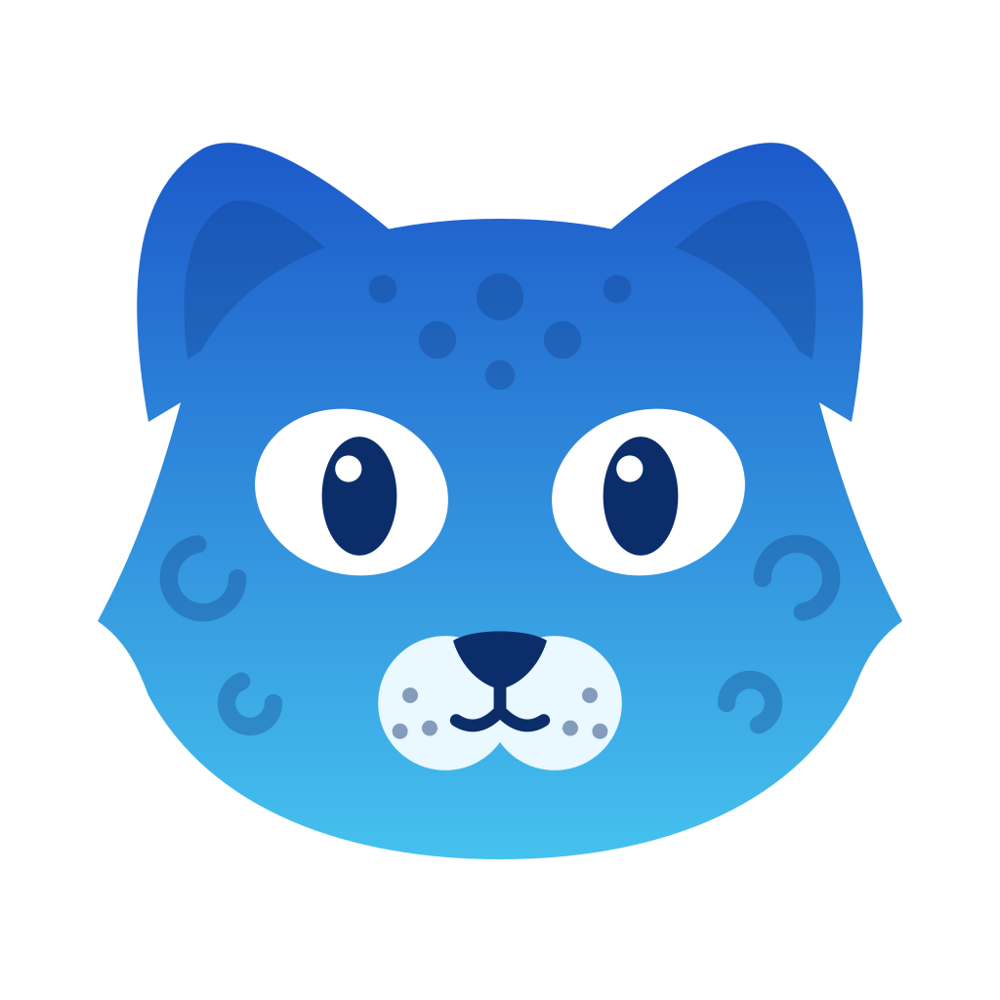
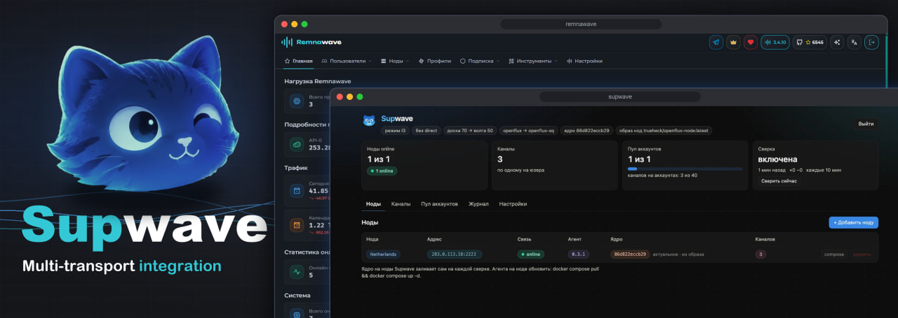

<p align="center"></p>

<p align="center"></p>

Supwave — дополнение к [Remnawave](https://github.com/remnawave): каждому юзеру из
выбранных сквадов — свой канал-обход [OpenFlux](https://github.com/p1neappleXpress/OpenFlux)
через Яндекс Доски и Яндекс Документы, по желанию — ещё через комнаты cups.online и Avito
Code. Канал сам появляется в обычной подписке юзера —
в клиенте Avaca, который понимает `openflux://`. Остальным клиентам подписка отдаётся
без изменений.

Клиент ходит только к сервисам носителей (Яндекс, а если включены — cups.online и Авито),
нода — тоже. К IP ноды клиент не подключается, и для клиентов на ноде не открыто ни одного
порта: блокировка IP или подсети ноды канал не задевает, а домены Яндекса — в белых списках.

## Что умеет

- **Канал на юзера.** Свои доска и документ на аккаунте оператора, свои комнаты cups.online
  и Авито, свой ключ. Подписка истекла, юзера отключили или убрали из сквада — канал
  снимается на ближайшей сверке.
- **Носители ползунками:** доска, волга, cups, Авито — набор для новых каналов в
  «Настройках» и свой у любого канала (столбец «Носители» во вкладке «Каналы»: канал
  пересоздаётся с выбранными, юзер получит новую ссылку со следующей подпиской).
- **Ноды как у remnanode.** «Добавить ноду» в веб-морде выдаёт готовый
  `docker-compose.yml`, на ноде остаётся `docker compose up -d`. Ядро на ноды Supwave
  обновляет сам.
- **Веб-морда на домене панели:** ноды (online / processing / offline), каналы (носитель,
  трафик, клиент, вход в Яндекс, CPU и память, журнал канала), пул аккаунтов Яндекса,
  журнал, «Сверить сейчас».
- **Настройки без правки `.env`:** каким сквадам Remnawave давать openflux, с какими
  носителями заводить каналы, как назвать профиль в приложении, каким клиентам (по
  User-Agent) дописывать ссылку.

## Как устроено

```
Клиент (Avaca) ───────────подписка──► Caddy (subs.) ──► Supwave ──► Remnawave API
          │                                               │  сверка: кому завести канал,
          │                                               │  у кого снять
          │                                               │  HTTPS, закреплённый сертификат,
          ▼                                               ▼  только с IP панели
  Яндекс Доски / Документы ◄──────────────────────── нода: openflux-node (агент + ядро)
```

- **Supwave** (`augmenter/`) стоит перед страницей подписки Remnawave. Клиенту с меткой
  в User-Agent он дописывает его персональную `openflux://`-ссылку, остальным отдаёт
  подписку байт в байт. Сверка (раз в 10 минут) заводит каналы юзерам выбранных
  сквадов и снимает у выбывших.
- **Нода** — один контейнер `openflux-node`: агент держит каналы (по процессу ядра на
  канал), поднимает их после рестарта, принимает ядро от Supwave.
- **Канал**: доска — основной носитель (быстрый, гостю без входа), документ («волга») —
  запасной; cups.online и Авито — анонимные комнаты, включаются ползунком. Трафик идёт
  через живой носитель с наивысшим приоритетом: доска 70 → cups 60 → Авито 55 → волга 50
  (`OPENFLUX_PRIORITIES`).

## Что нужно

- Remnawave (панель и `remnawave-subscription-page`) за **Caddy**, всё в Docker, сеть
  `remnawave-network`.
- Сервер под ноду за пределами РФ: Linux **amd64**, Docker.
- Аккаунт Яндекса (лучше несколько) и его `cookies.txt`: на нём создаются доски и документы.
- Клиент Avaca (Android): он понимает `openflux://` и шлёт метку `AVACA-Pod`.

## Установка

### 1. Supwave на сервере панели

```bash
cd /opt && git clone https://github.com/QJEqq/supwave && cd supwave/augmenter
cp .env.example .env && nano .env
```

Заполни блок «Обязательно»: `REMNAWAVE_API_URL`, `REMNAWAVE_API_TOKEN` (панель → Settings →
API Tokens), `ADMIN_TOKEN` (`openssl rand -hex 32`), `ADMIN_HOSTS` (домен панели), `PANEL_IP`.

```bash
docker compose up -d --build
```

Сборка сама берёт ядро и агента из образа ноды — Go не нужен.

### 2. Caddy

В `Caddyfile`: на домене подписки через Supwave идут только клиенты с меткой, остальные —
прямо к странице подписки, как без Supwave; на домене панели — один маршрут `/augmenter*`
(имя контейнера Remnawave и порт — как у тебя):

```
https://subs.example.com {
    encode
    # Через Supwave — только клиенты с меткой из «Настроек → Клиенты». Happ, браузер и
    # прочие идут прямо к странице подписки: Supwave им ничего не дописывает, и любая его
    # беда их не касается.
    @supwave header_regexp User-Agent AVACA-Pod
    handle @supwave {
        # Supwave упал — Caddy сам отдаёт обычную подписку Remnawave (без openflux)
        reverse_proxy http://augmenter:8080 http://remnawave-subscription-page:3010 {
            lb_policy first
            lb_try_duration 3s
            fail_duration 30s
        }
    }
    handle {
        reverse_proxy http://remnawave-subscription-page:3010
    }
}

https://panel.example.com {
    encode
    handle /augmenter* {
        reverse_proxy http://augmenter:8080
    }
    reverse_proxy * http://remnawave:3000
}
```

```bash
docker exec caddy caddy validate --config /etc/caddy/Caddyfile && docker exec caddy caddy reload --config /etc/caddy/Caddyfile
```

Добавишь клиента в «Настройках» — допиши его метку и в `header_regexp` (через `|`).

### 3. Веб-морда

Открой `https://panel.example.com/augmenter/` и войди по `ADMIN_TOKEN`.

### 4. Аккаунты Яндекса

Войди в Яндекс в браузере, выгрузи куки в `cookies.txt` (формат Netscape, любым
расширением экспорта — годится и полный экспорт, возьмутся только куки `yandex.ru`) и
добавь его в «Пул аккаунтов → Добавить аккаунт». Один аккаунт держит до 40 каналов
(`POOL_MAX_DOCS_PER_ACCOUNT`) — для многих юзеров добавь несколько.

Выгружай с открытой вкладки `yandex.ru` или `boards.yandex.ru`, войдя именно в этот аккаунт:
вход только через `ya.ru` оставляет куки на `.ya.ru`, и доски не создаются
(`createBoard: … init-csrf: код 201`). Проверить вход всех аккаунтов пула (значения кук не
печатаются, ничего не создаётся):

```bash
cd /opt/supwave/augmenter && docker exec -i augmenter python - < tools/pool_check.py
```

### 5. Нода

«Ноды → Добавить ноду» → имя и IP. Морда покажет compose и команды — на ноде:

```bash
curl -fsSL https://get.docker.com | sh
```
```bash
ufw allow from <IP панели> to any port 2223 proto tcp
```
```bash
mkdir -p /opt/openflux-node && nano /opt/openflux-node/docker-compose.yml
```
(вставить compose из морды)
```bash
cd /opt/openflux-node && docker compose up -d
```

Через минуту нода в морде станет `online`, ядро Supwave зальёт сам.

### 6. Кому openflux

«Настройки»:
- **Кому openflux** — отметь сквады Remnawave (или «всем активным»). Пока не выбрано —
  openflux никому.
- **Клиенты** — метки User-Agent: по умолчанию `AVACA-Pod` (её шлёт Avaca). Голую `Happ`
  не добавляй: тогда openflux получат все Happ.
- **Имя в подписке** — как профиль называется в приложении (`{node}` — имя ноды).

Нажми «Сверить сейчас» — каналы заведутся, и в подписке клиентов появится `openflux://`.

## Боевая панель: перед запуском

- **Сначала — прозрачно.** После установки openflux не получает никто, пока в «Настройках»
  не выбраны сквады: Supwave просто отдаёт подписку Remnawave как есть. Проверь, что
  обычные клиенты и страница подписки в браузере работают, и только потом выбирай сквады.
- **Начни с маленького сквада.** Заведи в Remnawave сквад на несколько юзеров (себя),
  выбери его, «Сверить сейчас», посмотри «Каналы». Потом расширяй.
- **Ёмкость.** Каждый канал — свой процесс ядра на ноде: память на канал видна в столбце
  «Ядро», умножь на число юзеров. Один аккаунт Яндекса — до 40 каналов.
- **Запасной путь подписки** — как в Caddy выше: если Supwave недоступен, юзеры всё равно
  получают обычную подписку.
- **Бэкап** тома `augmenter-data` (ссылки юзеров, куки пула, ключи нод, настройки):
  ```bash
  docker run --rm -v augmenter-data:/d -v "$PWD":/b alpine tar czf /b/augmenter-data.tgz -C /d .
  ```
- **Одна нода — одна панель.** Ноду, заведённую в другом Supwave, перед подключением
  очисти: `docker compose down -v` в её папке, затем новый compose из морды.

## Обновление

```bash
cd /opt/supwave && git pull && cd augmenter && docker compose up -d --build
```

Новое ядро ноды получат сами на ближайшей сверке. Агент на ноде (редко):

```bash
cd /opt/openflux-node && docker compose pull && docker compose up -d
```

## Обслуживание

- Журнал — вкладка «Журнал» (или `docker logs augmenter`), журнал канала — кнопка
  «журнал» в «Каналах».
- Пересоздать канал юзера — «Каналы → пересоздать». Снести все каналы и завести заново:
  ```bash
  docker exec -i augmenter python - --yes < tools/reset_channels.py
  ```
  (без `--yes` — только покажет, что снесёт), затем `docker restart augmenter`.

## Безопасность

- Веб-морда отвечает только на доменах из `ADMIN_HOSTS`, вход — `ADMIN_TOKEN`; без токена
  API отвечает пустым 404, `/docs` и `/openapi.json` выключены.
- На ноде открыт только порт агента (2223) и только для IP панели; связь — HTTPS с
  закреплённым сертификатом и токеном.
- Куки аккаунтов Яндекса хранятся в базе Supwave (том `augmenter-data`) и уходят на ноды
  каналов. `SECRET_KEY` в compose ноды — её ключ: не пересылай его.

## Ограничения (MVP)

- Ноды — только linux/amd64.
- Волга медленная (Яндекс режет до единиц КБ/с) — это запасной носитель; основной — доска.
- cups.online и Авито ограничивают частоту по адресу: каналы одной ноды делят этот лимит
  (cups — около 70 КБ/с, Авито — около 24 КБ/с на канал). Авито пускает 10 подключений в
  минуту с адреса, поэтому после рестарта ноды его комнаты поднимаются минутами.
- cups и Авито нужны свежие ядра на ноде и в приложении (фиксы от 17.11.2026).
- Клиенту для волги нужен свой вход в Яндекс (в приложении); доска работает без входа.
- Доступ снимается на сверке — до `RECONCILE_INTERVAL` (10 минут), вебхуков Remnawave нет.
- Массовое создание досок и документов Яндекс может пресечь — держи в пуле несколько
  аккаунтов.

## Из исходников

Ядро, агент ноды (`cmd/ofnode`) и сборщик ссылок (`cmd/oflink`) — в форке OpenFlux,
ветка `avaca-0.17`: <https://github.com/QJEqq/OpenFlux/tree/avaca-0.17>.

Свой образ ноды:
```bash
GOOS=linux GOARCH=amd64 CGO_ENABLED=0 go build -trimpath -ldflags='-s -w' -o node-kit/openflux .
```
(так же `./cmd/ofnode` → `node-kit/ofnode`, `./cmd/oflink` → `node-kit/oflink`), затем
```bash
sh node-kit/publish.sh <логин>/openflux-node
```
и в `.env` Supwave `OPENFLUX_NODE_IMAGE=<логин>/openflux-node:latest`, сборка Supwave —
`docker compose build --build-arg NODE_IMAGE=<логин>/openflux-node:latest`.
Сборка с бинарями, лежащими рядом, — `augmenter/Dockerfile.local`.

## Структура

| папка | что |
|---|---|
| `augmenter/` | Supwave: `app.py` (подписка, API), `admin_ui.py` (веб-морда), `reconcile.py` (сверка), `provisioner.py` (заведение каналов), `nodes.py`/`nodeapi.py` (ноды), `accounts.py` (пул), `settings.py` (настройки морды), `remnawave.py`, `tools/` |
| `node-kit/` | образ ноды из готовых бинарей: `Dockerfile.bin`, `publish.sh`, шаблон compose |
| `brand/` | логотип и баннер |

## Лицензия

GPL-3.0 — как у OpenFlux, на котором всё построено (`augmenter/node-install.sh` взят из
OpenFlux).
